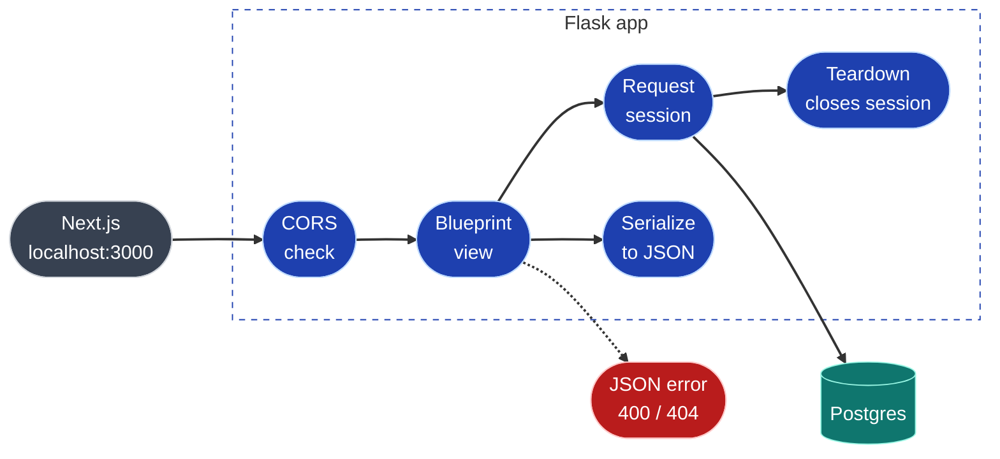

# API

Flask REST API over the pipeline's Postgres tables. Read-only except for
marking a signal as seen. Served under `/api`, JSON in and out.

```bash
cd backend && source .venv/bin/activate
flask --app api run --port 5001 --debug     # http://localhost:5001/api/health
python -m pytest                            # runs against antibody_landscape_test
```

Port 5001, not 5000: on macOS, port 5000 belongs to the AirPlay Receiver.

## How a request flows



- `create_app()` in `backend/api/__init__.py` builds the app; one blueprint per resource.
- Each request opens one SQLAlchemy session on first use (`api/database.py`) and
  closes it on teardown, rolling back if the view raised.
- CORS allows `http://localhost:3000` by default; set `CORS_ORIGINS`
  (comma-separated) to change it. CORS is enforced by browsers only; it is not auth.
- Enums are returned as their string values, dates as `YYYY-MM-DD`, and
  timestamps as ISO 8601 in UTC (`2026-10-13T09:01:05+00:00`).

## Endpoints

| Method | Path | Returns |
|---|---|---|
| GET | `/api/health` | API + database status, latest run |
| GET | `/api/landscape` | counts per target x stage (overview) |
| GET | `/api/landscape?target=PD-1` | antibodies hitting a target, one column per stage |
| GET | `/api/antibodies/<id>` | antibody, chains, liabilities, linked trials |
| GET | `/api/signals` | signal feed, newest first, filterable, paginated |
| POST | `/api/signals/<id>/seen` | marks a signal reviewed (idempotent) |
| GET | `/api/runs` | pipeline run history, newest first |

Examples below come from the test fixture (fictional antibodies), trimmed with `…`.

### GET /api/health

`200` when Postgres answers; `503 {"status": "error", "database": "unreachable"}` when not.

```json
{
  "status": "ok",
  "database": "ok",
  "latest_run": { "id": 4, "status": "running", "finished_at": null }
}
```

### GET /api/landscape?target=HER2

| Param | Values |
|---|---|
| `target` | `PD-1`, `PD-L1`, `HER2`, `CD20`, `IL-23` (case-insensitive). Anything else: `400`. |

Filters on the `targets` array (`targets @> ARRAY['HER2']`, GIN-indexed), so a
bispecific appears under each target it hits. Always returns all seven columns,
ordered `preclinical (0) … approved (5)`, then `unknown` (`stage_rank: null`).
Antibodies within a column are sorted by name.

```json
{
  "target": "HER2",
  "total": 2,
  "columns": [
    { "stage_rank": 0, "stage": "preclinical", "label": "Preclinical", "count": 0, "antibodies": [] },
    {
      "stage_rank": 1, "stage": "phase_1", "label": "Phase 1", "count": 1,
      "antibodies": [
        {
          "id": 2, "inn_name": "duotamab", "display_name": "Duotamab",
          "targets": ["PD-1", "HER2"], "format": "Bispecific",
          "clinical_stage": "phase_1", "stage_rank": 1, "status": "active"
        }
      ]
    },
    …
    { "stage_rank": null, "stage": "unknown", "label": "Unknown", "count": 0, "antibodies": [] }
  ]
}
```

### GET /api/landscape

Without `target`: counts per tracked target x stage. A bispecific counts under
each of its targets, so per-target totals can add up to more than
`antibodies_total` (distinct antibodies).

```json
{
  "stages": [ { "stage_rank": 0, "stage": "preclinical", "label": "Preclinical" }, … ],
  "targets": [
    {
      "target": "PD-1", "total": 3,
      "counts": { "preclinical": 0, "phase_1": 1, "phase_2": 1, "phase_3": 0,
                  "filed": 0, "approved": 1, "unknown": 0 }
    },
    …
  ],
  "antibodies_total": 6
}
```

### GET /api/antibodies/&lt;id&gt;

Unknown or non-integer id: `404`. Loaded with `selectinload`: always 4 queries
(antibody, chains, liabilities, trials), however many chains or trials.

- `chains` are ordered H1, H2, L1, L2.
- `cdr3_start` / `cdr3_end` are 1-based and inclusive, from the same regex the
  pipeline used, so they agree with each liability's `in_cdr3`. Both are `null`
  when the CDR3 pattern found no match.
- `liabilities` are sorted by `position` (1-based).
- `liability_counts` are exact per chain. The antibody-level total sums the
  chains, so a common-chain bispecific (two identical heavy chains) counts the
  shared chain's liabilities twice.
- `trials`: newest `last_update_date` first, undated last.

```json
{
  "id": 2, "inn_name": "duotamab", "display_name": "Duotamab",
  "targets": ["PD-1", "HER2"], "format": "Bispecific",
  "clinical_stage": "phase_1", "stage_rank": 1, "status": "active",
  "target": "PD-1",
  "source_url": "https://opig.stats.ox.ac.uk/webapps/sabdab-sabpred/therasabdab/search/?therapeutic=Duotamab",
  "created_at": "2026-10-14T01:41:42.659382+00:00",
  "updated_at": "2026-10-14T01:41:42.659382+00:00",
  "liability_counts": { "high": 4, "medium": 8, "low": 4, "in_cdr3": 7, "total": 16 },
  "chains": [
    {
      "id": 3, "chain_type": "H", "chain_index": 1, "length": 118,
      "sequence": "EVQLVESGGGLVQPGGSLRLSCAASGFTFSNSAMSW…YYCAKWGNSTYFDVWGQGTLVTVSS",
      "cdr3_sequence": "AKWGNSTYFDV", "cdr3_len": 11, "cdr3_start": 97, "cdr3_end": 107,
      "liability_counts": { "high": 1, "medium": 5, "low": 1, "in_cdr3": 3, "total": 7 },
      "liabilities": [
        { "id": 14, "kind": "deamidation", "motif": "NS", "position": 31, "in_cdr3": false, "severity": "medium" },
        …
        { "id": 8, "kind": "n_glycosylation", "motif": "NST", "position": 101, "in_cdr3": true, "severity": "high" }
      ]
    },
    …
  ],
  "trials": [
    {
      "id": 2, "nct_id": "NCT09000001",
      "title": "Exemplimab plus Duotamab in solid tumors", "sponsor": "Example Bio",
      "status": "RECRUITING", "phase": "PHASE2", "enrollment": 120,
      "last_update_date": "2026-10-01",
      "source_url": "https://clinicaltrials.gov/study/NCT09000001"
    },
    …
  ]
}
```

### GET /api/signals

| Param | Values | Default |
|---|---|---|
| `since` | ISO date or datetime; dates are midnight UTC, naive times UTC | — |
| `kind` | one or more of `TRIAL_STATUS_CHANGED`, `TRIAL_PHASE_CHANGED`, `NEW_TRIAL`, `ANTIBODY_STAGE_CHANGED`, `NEW_ANTIBODY`, comma-separated, any case | — |
| `seen` | `true` / `false` | — |
| `run_id` | a run id, or `latest` (newest finished run) | — |
| `limit` | 1–200 | 50 |
| `offset` | ≥ 0 | 0 |

Any invalid value: `400`, with the allowed values in `details`. Newest first.
`entity` resolves the polymorphic `entity_type` / `entity_id` to a label and the
antibodies to link to (a trial lists every linked antibody); it is `null` when
the entity no longer exists. Entities are batch-loaded: at most 5 queries per page.

```json
{
  "items": [
    {
      "id": 2, "run_id": 3, "kind": "NEW_TRIAL",
      "title": "New trial NCT09000002 for Duotamab",
      "old_value": null, "new_value": "RECRUITING",
      "source_url": "https://clinicaltrials.gov/study/NCT09000002",
      "entity_type": "trial", "entity_id": 4,
      "entity": { "label": "NCT09000002", "antibodies": [ { "id": 2, "display_name": "Duotamab" } ] },
      "seen": false, "seen_at": null,
      "created_at": "2026-10-13T09:01:05+00:00"
    },
    …
  ],
  "total": 6, "limit": 2, "offset": 0
}
```

Unseen badge count: `GET /api/signals?seen=false&limit=1`, then read `total`.

Pagination is offset-based. For a live feed, keyset pagination on
`(created_at, id)` would avoid items repeating across pages when new signals arrive.

### POST /api/signals/&lt;id&gt;/seen

No body. Sets `seen = true` and `seen_at = now()`; calling it again keeps the
original `seen_at`. Returns the updated signal (same shape as a feed item).
Unknown id: `404`.

```json
{ "id": 2, "kind": "NEW_TRIAL", …, "seen": true, "seen_at": "2026-10-14T01:41:44.782996+00:00" }
```

### GET /api/runs

| Param | Values | Default |
|---|---|---|
| `limit` | 1–200 | 20 |

`duration_seconds` is `null` while a run is still running. `counts` is the run's
summary exactly as `pipeline/run.py` wrote it (JSONB, so key order isn't preserved).

```json
{
  "items": [
    {
      "id": 3, "status": "partial",
      "started_at": "2026-10-13T09:00:00+00:00",
      "finished_at": "2026-10-13T09:01:10.250000+00:00",
      "duration_seconds": 70.25,
      "counts": { "trials": 4, "signals": 3, "antibodies": 6, "ctgov_failed": 1 },
      "raw_location": "data/raw/3",
      "error": null
    },
    …
  ],
  "total": 4, "limit": 2
}
```

## Errors

Every error has the same shape, including unknown routes (`404`), wrong methods
(`405`) and unexpected failures (`500`, details logged server-side only):

```json
{
  "error": {
    "status": 400,
    "code": "bad_request",
    "message": "Unknown target 'EGFR'",
    "details": { "allowed": ["PD-1", "PD-L1", "HER2", "CD20", "IL-23"] }
  }
}
```

## Tests

`backend/tests/` runs against a separate database: your `.env` `DATABASE_URL`
with `_test` appended to the name (created if missing, migrated with Alembic,
reseeded before every test). Tests refuse to run against a database whose name
doesn't end in `_test`, because every test truncates all tables. Override with
`TEST_DATABASE_URL`.

The fixture (`tests/fixtures.py`) has a PD-1 x HER2 bispecific with four chains,
liabilities in and out of CDR3 (generated by the pipeline's own `scan_chain`), a
chain with no CDR3 match, a trial linked to two antibodies, runs in every status
and a signal of every kind.