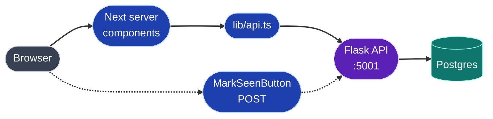

# Dashboard (frontend)

Next.js 16 (App Router, TypeScript, Tailwind v4) dashboard over the Flask API in
`backend/api/`. Four pages: the competitive landscape, antibody detail
(sequences, CDR3, developability liabilities, trials), the signal feed, and
pipeline run history.

API contract: [`docs/api.md`](../docs/api.md).

## Run it

You need Postgres (Docker), the Flask API and the Next dev server.

```bash
# 1. Postgres
docker compose up -d

# 2. API (terminal 1), port 5001 because macOS uses 5000 for AirPlay
cd backend && source .venv/bin/activate
flask --app api run --port 5001 --debug

# 3. Dashboard (terminal 2)
cd frontend
npm install        # first time only
npm run dev        # http://localhost:3000
```

### Configuration

| File | Variable | Value |
|---|---|---|
| `frontend/.env.local` (git-ignored) | `NEXT_PUBLIC_API_URL` | `http://localhost:5001` |
| `.env` (repo root) | `CORS_ORIGINS` | `http://localhost:3000` |

Restart Flask after changing `CORS_ORIGINS`, and restart `npm run dev` after
changing `.env.local`.

## Pages

| Route | What it shows | API calls |
|---|---|---|
| `/?target=PD-1` | Target picker + 7-column stage matrix (preclinical → approved, unknown) | `GET /api/landscape?target=`, `GET /api/landscape` |
| `/antibodies/[id]` | Header, summary tiles, each chain's sequence with CDR3 shaded and liabilities marked, liability table, trials | `GET /api/antibodies/<id>` |
| `/signals` | Feed (Latest run / Unseen / All, filter by kind, pagination), "Mark seen" | `GET /api/signals`, `POST /api/signals/<id>/seen` |
| `/runs` | Run cards: status, duration, counts, step-timing bars, errors | `GET /api/runs` |

The nav shows an unseen-signal badge (`GET /api/signals?seen=false&limit=1` → `total`).

## Layout

```
frontend/
├── lib/api.ts                      typed client: response types, apiGet, apiPost, ApiError
└── app/
    ├── globals.css                 semantic color tokens (light + dark)
    ├── layout.tsx                  nav + streamed unseen badge
    ├── error.tsx                   error boundary (shows the API's error message)
    ├── page.tsx                    landscape
    ├── antibodies/[id]/page.tsx    antibody detail
    ├── signals/page.tsx            signal feed
    ├── signals/MarkSeenButton.tsx  the only Client Component
    └── runs/page.tsx               run history
```

`[id]` is a literal folder name: brackets make the URL segment dynamic, and the
page reads it with `const { id } = await params`.

## How it works



Solid arrows run on the Next server; the dashed path is the one request the
browser makes directly.

- **Server Components fetch the data.** Pages `await` the API on the server, so
  there's no `useEffect`, no client data library, and the HTML arrives filled in.
  Server-to-Flask requests don't go through CORS.
- **Cache Components + Suspense.** `cacheComponents` is on, so Next prerenders a
  static shell (nav + skeleton) and streams the request-dependent part. Each
  page is a synchronous component that wraps an async view in `<Suspense>`;
  awaiting `searchParams`, `params` or the API outside a Suspense boundary
  raises a "Blocking Route" error.
- **State lives in the URL.** Target, signal view, kind and offset are query
  parameters and every control is a `<Link>`, so views are shareable, the back
  button works and pages need no client JavaScript.
- **One small Client Component.** `MarkSeenButton` POSTs from the browser (the
  only request that depends on the CORS allowlist), then calls
  `router.refresh()` so the row, the filters and the nav badge all re-render
  from the database instead of from local state.
- **Errors.** `apiGet` rethrows the API's `{"error": {...}}` message as an
  `ApiError`. A 404 on the detail page calls `notFound()`; anything else goes to
  `error.tsx`. The nav badge swallows errors so the nav renders with the API down.
- **Colors.** Components use semantic tokens only (`canvas`, `panel`, `ink`,
  `muted`, `line`, `accent`, `sev-*`, `cdr3`), defined once for light and once
  for dark mode in `globals.css`. Don't hardcode `bg-white`/`text-gray-*`:
  create-next-app's dark-mode body styles are unlayered and override Tailwind
  utilities, which is what made the first version unreadable.

### Antibody detail specifics

- CDR3 bounds (`cdr3_start`/`cdr3_end`) are 1-based and inclusive, from the same
  regex the pipeline used, so the shading agrees with each liability's `in_cdr3`.
- Residues covered by several motifs show the worst severity; the table lists all.
- Chains with an identical sequence to an earlier chain are tagged
  "same sequence as H1" (common-heavy-chain bispecifics such as Fidasimtamab).
  The antibody-level liability total counts that shared chain twice.
- Trials beyond the first 15 sit in a native `<details>` element.

## Demo script (~5 min)

**Before:** start Postgres, Flask and `npm run dev`; make sure run 5's signals
are unseen:

```bash
docker compose exec postgres psql -U alm -d antibody_landscape -c \
  "update signal set seen = false, seen_at = null where id in (28, 29, 30);"
```

1. **Landscape, PD-1** (55 antibodies). Columns are development stages. Point
   out that 4 of the 5 Phase 1 antibodies are discontinued.
2. **Switch to HER2.** Fidasimtamab appears under both targets: the API filters
   on the GIN-indexed `targets` array (`targets @> ARRAY['HER2']`), not the
   single `target` column.
3. **Open Fidasimtamab.** H1 and H2 are the same sequence (it's that way in
   Thera-SAbDab itself), so the total double-counts. Hover the CDR3 residues to
   show the liability details. **0 trials**: newer INNs are registered on
   ClinicalTrials.gov under development codes; the fix is alias search.
4. **Open an approved antibody** (e.g. Camrelizumab) for a full trials table.
5. **Signals → Latest run.** Three changes from run 5 with old → new values and
   links to the antibody and source. Click **Mark seen** and watch the nav badge
   drop: this is the one browser-side request.
6. **Runs.** `fetch_ctgov` is ~64 of ~70 s per run. If CT.gov's
   `ctgov_data_timestamp` hasn't changed, skipping that fetch is the biggest
   win. Run 4's 27 signals came from widening one search (a scope change looks
   like news; production would mark it as a backfill).

**After:** rerun the reset query above.

## Known issues and next steps

- **CT.gov trial counts may be capped.** Camrelizumab shows exactly 50 trials;
  check that the pipeline follows `nextPageToken` instead of reading one page.
- **Offset pagination** can repeat or skip signals when new ones arrive between
  page loads; keyset pagination on `(created_at, id)` fixes that.
- **No auth.** CORS only controls which browser origins can *read* responses. The
  mark-seen POST has no body, so it's a "simple" request with no preflight: it
  reaches Flask from any origin. Add auth (and CSRF protection) before deploying.
- **`raw_location`** in `/api/runs` is an absolute local path; the runs page
  hides it, but make it relative before anything is public.
- **No frontend tests.** Pages were checked by hand against the running API;
  Playwright smoke tests per page would be the next step.

## Troubleshooting

| Symptom | Fix |
|---|---|
| "Next.js encountered uncached data during prerendering" | Move the `await` into a component inside `<Suspense>` |
| Hydration warning about an attribute on `<html>` | A browser extension (e.g. Trancy) added it; `suppressHydrationWarning` is on `<html>` |
| Text invisible / light on white | A hardcoded color slipped in; use the tokens in `globals.css` |
| "Mark seen" shows "Failed to fetch" | CORS: `CORS_ORIGINS` must be exactly `http://localhost:3000`; restart Flask |
| Every page shows the error page | Flask isn't running on 5001, or `NEXT_PUBLIC_API_URL` is wrong |
| `/antibodies/...` returns 404 for a real id | Folder must be `app/antibodies/[id]/page.tsx` (brackets included) |
| zsh: "no matches found: app/antibodies/[id]" | Quote the path: `mkdir -p "app/antibodies/[id]"` |
| ESLint "Avoid constructing JSX within try/catch" | Put only the `await` in the `try`; render outside it |