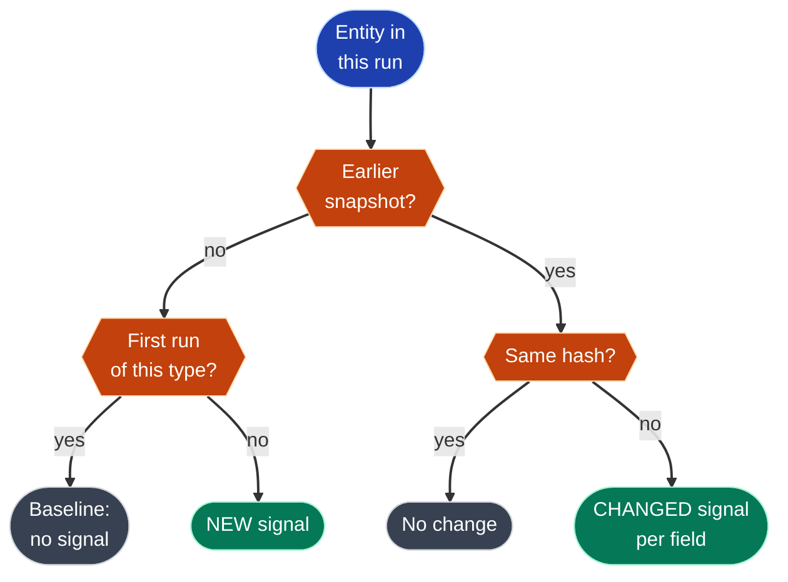

# Pipeline

How the Antibody Landscape Monitor turns public data into a current,
sourced view of the therapeutic-antibody landscape, and how to run it.

For every individual normalization rule and the reasoning behind it, see
[data-transformations.md](data-transformations.md).

## What it does

Every run:

1. downloads every published therapeutic antibody (Thera-SAbDab) and the
   clinical trials testing them (ClinicalTrials.gov)
2. keeps the antibodies hitting five tracked targets: PD-1, PD-L1, HER2, CD20, IL-23
3. scans every heavy and light chain for developability liabilities
4. compares everything with what earlier runs saw, and records each meaningful
   change as a **signal** with a link to its source

The output lives in Postgres and is served to the dashboard by a Flask API.

## Running it

```bash
cd backend && source .venv/bin/activate

python -m pipeline.run                  # full run, ~70 s
python -m pipeline.run --skip-ctgov     # antibodies + chain analysis only, ~2 s
python -m pipeline.run --ctgov-limit 5  # CT.gov for the first 5 antibodies only

python -m pipeline.demo_seed            # make the NEXT run emit demo signals
```

Prerequisites: Postgres running (`docker compose up -d`), migrations applied
(`alembic upgrade head`), and `DATABASE_URL` set in the repo-root `.env`.

Inspect results:

```bash
docker compose exec postgres psql -U alm -d antibody_landscape -P pager=off \
  -c "select id, status, counts->>'signals' signals, finished_at - started_at took from pipeline_run order by id desc limit 5"
```

---

## Architecture


Blue is the antibody half, purple the trial half, green the change detection.
The order matters: CT.gov is searched once per antibody, so it can only run
after the antibody list is known. Diff runs last, after everything this run
loaded.

### The step contract

Every step is a plain Python function:

```python
def step(event: dict) -> dict:
    ...
    return {**event, "new_key": value}
```

Each step receives the event built so far, does one job, and returns the event
plus what it added. `run.py` simply calls them in order.

This is the same contract as an AWS Lambda task, so the identical functions
can be wired into a Step Functions state machine. Two rules keep that possible:

- **Steps pass file paths, not data.** Step Functions caps the state passed
  between steps at 256 KB; the Thera-SAbDab CSV alone is 636 KB.
- **Steps don't share memory.** Anything a later step needs is in the event,
  a file, or the database.

### Where data lives

```
data/raw/<run_id>/            one folder per run (not committed)
    therasabdab.csv           raw download, exactly as received
    antibodies.json           normalized antibodies + chains
    ctgov/<inn>.json          raw CT.gov response per antibody
    trials.json               normalized, deduplicated trials
```

Raw files are kept so any run can be re-normalized after fixing a rule,
without re-downloading, and so it's always possible to see exactly what a
source said on a given day.

---

## The steps

### 1. `fetch_therasabdab` — download antibodies

Downloads the full Thera-SAbDab CSV (~1,100 therapeutics). Fails loudly if the
server returns a web page instead of a CSV, which is what happens when a
download link moves.

### 2. `normalize_antibodies` — clean and filter

Keeps antibodies hitting the five tracked targets (139 of ~1,100) and turns
each row into a clean record: target buckets, a standardized clinical stage
with a sortable rank, development status, up to four chains (two for a
bispecific's second arm), aliases, and a source link.

It also computes a **content hash**: a fingerprint of the fields that matter
(stage, status, targets, format, sequences), used later to skip unchanged
records. Details: [data-transformations.md](data-transformations.md#part-1--thera-sabdab-antibodies-and-chains).

### 3. `load_antibodies` — write to Postgres

Upserts antibodies by name and chains by `(antibody, H/L, index)`, then
appends one `antibody_snapshot` per antibody for this run.

### 4. `analyze_chains` — developability liabilities

For every chain it first locates **CDR3**, the loop that mostly decides what
the antibody binds, using a pattern anchored on conserved residues:

| Chain | CDR3 pattern |
|---|---|
| Heavy | `C(...)WG.G`: between the conserved Cys and the `WGxG` motif |
| Light | `C(...)FG.G`: between the conserved Cys and the `FGxG` motif |

Then it scans for short motifs that make antibodies unstable or hard to
manufacture:

| Liability | Motif | Severity |
|---|---|---|
| N-linked glycosylation | `N[^P][ST]` | high |
| Deamidation | `NG` (high), `NS` (medium) | high / medium |
| Isomerization | `DG`, `DS` | medium |
| Unpaired cysteine | odd number of `C`; flags the non-canonical one | high |
| Oxidation | `M`, `W` inside CDR3 only | low |

Each hit is stored with its motif, 1-based position, severity, and whether it
falls inside CDR3. Example, pembrolizumab:

| Chain | CDR3 | Liabilities |
|---|---|---|
| Heavy | `ARRDYRFDMGFDY` | `NG` at 55 (CDR2, high), `DS` at 73 (framework, medium), `M` at 105 (CDR3, low) |
| Light | `QHSRDLPLT` | none |

Liabilities are *derived data*: they can always be recomputed from the
sequence, so each run replaces them rather than keeping history.

> This is deliberately lightweight. Production tools number every residue
> with a scheme such as IMGT or Chothia (e.g. ANARCI) to place CDRs exactly.
> The regexes miss 3 of 357 chains, all non-standard formats.

### 5. `fetch_ctgov` — download trials

For each antibody, asks CT.gov API v2 for the 50 most recently updated trials
using it as an intervention. It pauses briefly between requests, retries
429 and 5xx responses with backoff, and records an antibody whose request still
fails in `ctgov_failed` instead of failing the run. It also records CT.gov's
`dataTimestamp`, which says when CT.gov last refreshed its data (weekdays,
~9am ET).

Thera-SAbDab adds a digit to multi-entry therapeutics (`pumitamig2`), so the
digit is stripped from the search term only.

### 6. `normalize_trials` — clean and deduplicate

Extracts NCT ID, title, sponsor, status, phase, enrollment and last-update
date. Combination trials appear under several antibodies, so trials are merged
by NCT ID into one record listing every linked antibody; if copies differ, the
most recently updated one wins.

### 7. `load_trials` — write to Postgres

Upserts trials by NCT ID, links them to antibodies in `antibody_trial`, and
appends one `trial_snapshot` per trial for this run.

### 8. `diff_signals` — detect changes

Compares each entity seen in this run with **its own most recent snapshot from
any earlier run**:



| Signal | Fires when |
|---|---|
| `ANTIBODY_STAGE_CHANGED` | clinical stage differs, e.g. `phase_3 → approved` |
| `NEW_ANTIBODY` | a tracked-target antibody appears for the first time |
| `TRIAL_STATUS_CHANGED` | e.g. `RECRUITING → ACTIVE_NOT_RECRUITING` |
| `TRIAL_PHASE_CHANGED` | e.g. `PHASE2 → PHASE2\|PHASE3` |
| `NEW_TRIAL` | a trial enters tracking for the first time |

Every signal stores the old value, new value, run, a readable title, and a
`source_url` (the CT.gov study page or Thera-SAbDab entry). The database
rejects a signal without a source.

Why "latest earlier snapshot" and not "previous run": a run with
`--skip-ctgov`, or one where CT.gov failed, has no trial snapshots. Comparing
against it would make all ~2,400 trials look new on the next run.

---

## Data model

```
antibody ──< chain ──< liability
   │  └──< antibody_snapshot (one per run)
   │
   >──< trial ──< trial_snapshot (one per run)        (via antibody_trial)

pipeline_run ──< signal      signal → antibody or trial (entity_type + entity_id)
```

| Table | Holds | Written by |
|---|---|---|
| `antibody` | current values: name, targets, format, stage, rank, status, source URL | load (upsert) |
| `chain` | sequence, length, CDR3 sequence and length per H/L chain | load, analyze |
| `liability` | motif, position, severity, in-CDR3 flag | analyze (replaced each run) |
| `antibody_snapshot` | stage + content hash per antibody per run | load (append only) |
| `trial` | current values: status, phase, enrollment, sponsor, dates | load (upsert) |
| `trial_snapshot` | status, phase, enrollment + hash per trial per run | load (append only) |
| `antibody_trial` | which antibodies a trial tests | load (insert only) |
| `pipeline_run` | status, timings, counts, raw data location, error | run.py |
| `signal` | detected change, old → new, source URL, seen flag | diff |

**Current values vs snapshots:** the entity tables answer "what is true now?"
quickly for the dashboard. Snapshots answer "what was true at run N?", which
is what diffing, auditing and a future rollback need.

---

## Design principles

| Principle | How it shows up |
|---|---|
| **Idempotent** | Every load is an upsert or `ON CONFLICT DO NOTHING`. Re-running a step for the same run changes nothing and never hits a unique-constraint error. |
| **Never delete source data** | Antibodies and trials that vanish from a source keep their rows, history and signals. Only derived data (liabilities, a re-diffed run's signals) is replaced. |
| **Fail loudly, degrade gracefully** | Changed source columns or an HTML "CSV" stop the run with a clear error. One antibody's CT.gov failure marks the run `partial` and the rest still loads. |
| **Every claim is sourced** | Signals carry a source URL, enforced by a CHECK constraint. |
| **Keep raw inputs** | Each run's raw files are kept, so normalization can be re-run and audited. |
| **Cheap change detection** | Content hashes skip unchanged records without comparing field by field. |

## Run lifecycle

`run.py` creates a `pipeline_run` row (`running`), passes one event through
every step, and finishes with:

| Status | Meaning |
|---|---|
| `succeeded` | every step completed |
| `partial` | completed, but some antibodies' CT.gov requests failed |
| `failed` | a step raised; the error and traceback are saved on the run |

`counts` on the run holds everything the dashboard's Runs page shows:
antibodies by target, chains, liabilities by severity, trials, links, signals
by kind, CT.gov data timestamp, and seconds per step.

## Demo signals

CT.gov changes at most once per weekday, so two runs in a row usually produce
no signals. `demo_seed.py` rewrites the latest stored snapshot of two
pembrolizumab trials and pembrolizumab itself to an earlier state. The next run
fetches the true current state, so the resulting signals' *new* values and
source links are real:

```
TRIAL_STATUS_CHANGED    NCT02600949 (Pembrolizumab): RECRUITING → ACTIVE_NOT_RECRUITING
TRIAL_STATUS_CHANGED    NCT01174121 (Pembrolizumab): NOT_YET_RECRUITING → RECRUITING
ANTIBODY_STAGE_CHANGED  Pembrolizumab: filed → approved
```

---

## Current numbers (run 5, Oct 13 2026)

| | |
|---|---|
| Antibodies | 139: PD-1 55, PD-L1 38, HER2 20, CD20 19, IL-23 9 |
| Chains | 357 (bispecifics contribute up to 4) |
| Liabilities | 702: 64 high, 426 medium, 212 low |
| Chains without a CDR3 match | 3 |
| Trials / antibody–trial links | 2,381 / 2,592 |
| Full run | ~70 s, of which the CT.gov fetch is ~65 s |

## Known limitations and next steps

| Limitation | Impact | Next step |
|---|---|---|
| CT.gov searched by INN only | ~40 of 139 antibodies (mostly newer drugs registered under codes like BNT327) find no trials | search stored aliases too, filtering ambiguous short codes |
| 50 trials per antibody | older but still active trials can be missed | full pagination, incremental by last-update date |
| Widening the search looks like news | the pumitamig fix produced 27 `NEW_TRIAL` signals | flag scope-change sweeps as backfill, not alerts |
| Regex CDR3 | 3 non-standard chains unmatched; boundaries approximate | ANARCI with IMGT numbering |
| Framework motifs dominate "medium" | every antibody looks similarly risky | rank by region and severity in the UI |
| Sequential CT.gov requests | run time grows with antibodies tracked | Step Functions Map state: one task per antibody, in parallel |
| Skips nothing when CT.gov is unchanged | wasted ~65 s when `dataTimestamp` hasn't moved | skip CT.gov if the timestamp matches the last run |
| Name is the identity | a renamed INN looks like delete + new | match on aliases before creating an antibody |